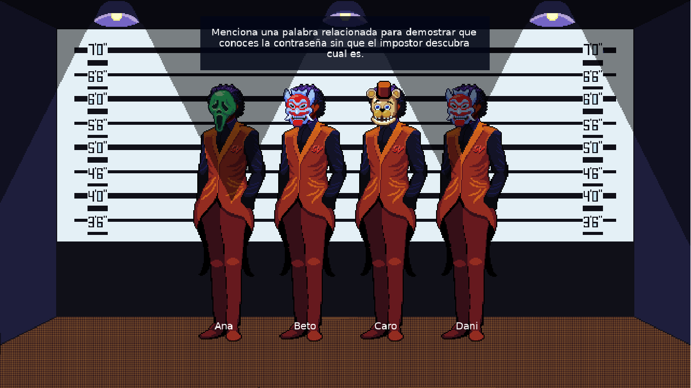
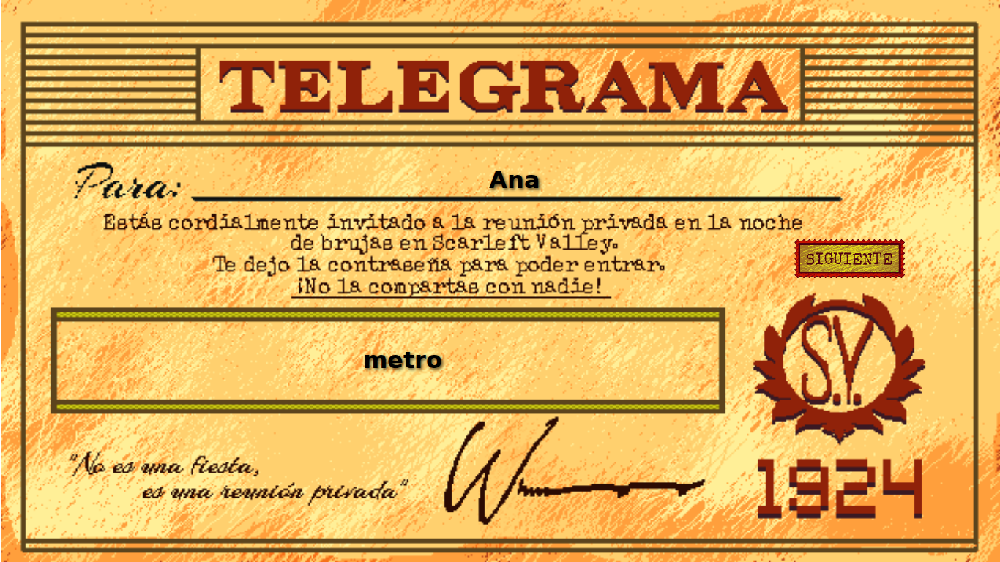
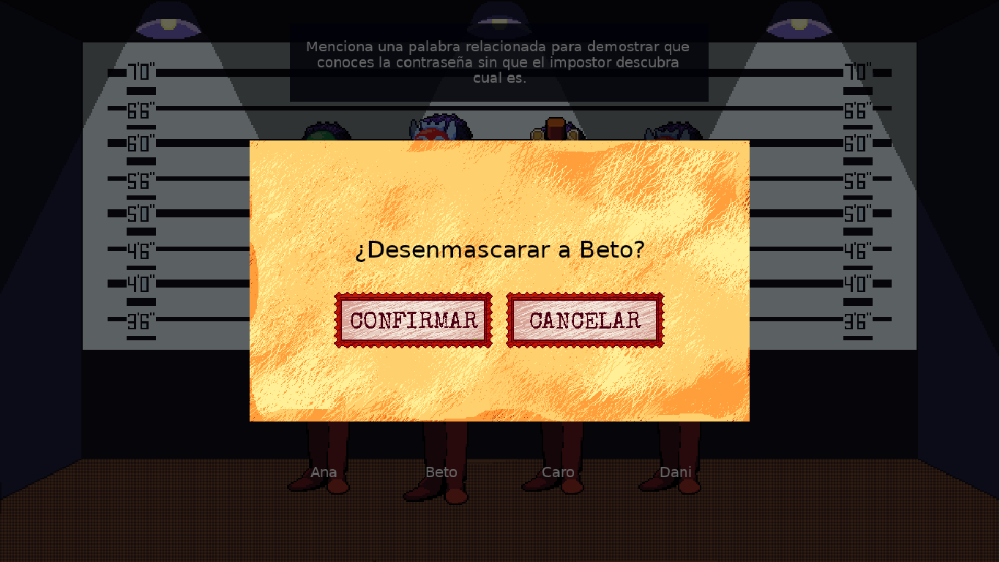

# Invitado especial

Juego de deducción social para 3 a 6 personas en una sola pantalla, hecho en 48 horas para la **Global Game Jam 2026**.

**[Jugar en el navegador](https://diegoof07.github.io/invitado-especial-ggj/)**

> Noche de brujas de 1924 en Scarlett Valley. La fiesta privada pide una contraseña para entrar y uno de los enmascarados no la conoce. Encuéntrenlo antes de que se salga con la suya.



## Cómo se juega

1. Cada quien escribe su nombre o apodo.
2. El dispositivo pasa de mano en mano. Cada jugador abre su telegrama y lee la contraseña en secreto. El impostor solo ve la categoría.
3. En la rueda de reconocimiento, cada uno dice una palabra relacionada con la contraseña: lo bastante clara para probar que la conoce, pero sin regalársela al impostor.
4. El grupo vota y desenmascara a un sospechoso. Si atrapan al impostor, ganan los invitados; si quedan tantos impostores como invitados, gana el impostor.

| Telegrama | Desenmascarar |
|---|---|
|  |  |

## Cómo está hecho

- **Vue 3 + TypeScript** para las pantallas de menú, configuración, telegrama y resultado, con **Vue Router**.
- **Phaser 3** solo para la rueda de reconocimiento: sprites con máscaras al azar, hover, el diálogo para desenmascarar y la música del gameplay. Vue crea el juego de Phaser al terminar la ronda de telegramas y lo destruye al salir; la escena avisa de cada eliminación con un evento del navegador y Vue decide si la partida terminó.
- Arte en pixel art, música y efectos hechos por el equipo durante la jam.
- Phaser va en un chunk aparte que solo se descarga al empezar la partida.

## Correr en local

```bash
npm ci
npm run dev       # desarrollo
npm run build     # build de producción en dist/
npm run preview
```

Cada push a `main` publica el build en GitHub Pages con [este workflow](.github/workflows/pages.yml).

Está pensado para jugarse en computadora; en teléfono el telegrama no se acomoda bien.

## Assets originales

[`originales/`](originales) guarda el material tal como se creó en la jam: el audio en WAV y los bocetos de arte que no llegaron al juego. El juego usa copias en MP3 de ese audio (en `src/assets/Audio`) para que la página cargue rápido; las imágenes de `src/assets` son las originales.

## Equipo

Hecho por un equipo de 7 personas en la Global Game Jam 2026 ([página del juego en la jam](https://globalgamejam.org/games/2026/unmasked-2-1)).

- **Programación:** [Diego Flores](https://github.com/DiegoOF07), [Nils Muralles](https://github.com/nilsmuralles) e [Isabella Recinos](https://github.com/Isabella334)
- **Arte, música e historia:** Elisa Balcárcel, Crowvian, VipxrKing y Bazzel

La versión entregada en la jam está en la etiqueta [`ggj-2026`](../../tree/ggj-2026). Después se corrigieron las rutas de los assets para que el build de producción funcione (antes solo corría con el servidor de desarrollo), se pasó el audio de WAV a MP3 (de 25 MB a 2.4 MB) y se publicó en GitHub Pages.
